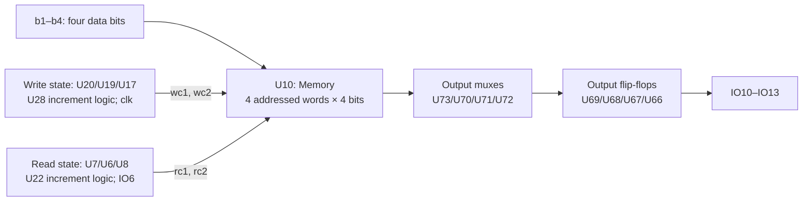

# Logic deduction: a four-word, four-bit FIFO

The circuit is best interpreted as a **four-word, four-bit first-in, first-out buffer with separate write and read clocks**. This describes its intended architecture. It does not establish that every detail of the supplied circuit implements a correct FIFO.

## Why this interpretation fits the schematic

U10 is annotated **Memory** in the embedded symbol. Its four data inputs are `b1`–`b4`; two write-address signals, `wc1` and `wc2`, and two read-address signals, `rc1` and `rc2`, select among four locations. The intended storage capacity is therefore **4 × 4 = 16 data bits**.

| Function | Schematic clues |
| --- | --- |
| Write position | U20, U19 and U17 form a three-bit state, with feedback selection and the U28 adder. The write-side clock is `clk`. |
| Read position | U7, U6 and U8 form a three-bit state, with feedback selection and the U22 adder. The read-side clock is `IO6`. |
| Address versus wrap | The lower two state bits address U10. The third bit, visible in `wc3` and `rc3`, participates in the pointer comparisons rather than selecting a fifth memory location. |
| Output data | U10 output pins 13–16 feed U73/U70/U71/U72, then U69/U68/U67/U66 and the `IO10`–`IO13` outputs. The first group contains mux symbols; the second contains flip-flops. |

For an ideal circular FIFO, let `W=(w2,w1,w0)` and `R=(r2,r1,r0)`, where the low two bits are the word address. Equal complete pointers indicate **empty**. Equal addresses with different third bits indicate **full**:

- `empty = (W = R)`
- `full = ((w1,w0) = (r1,r0)) AND (w2 != r2)`

This explains the extra pointer bit: the same physical address can mean either no queued words or one complete four-word lap. The schematic's comparison structure supports this interpretation. The equations describe the intended pointer convention, not a proved timing or reachable-state model of the literal hardware.

## What the retained checks actually establish

The source-bound local reset/enable analysis covers **32 ideal Boolean transition cases and 16 independent enable cases**. It explicitly treats mux selection, inverted flip-flop capture and Boolean gates as assumptions, with valid supplies and stable inputs.

The literal enable equations are `R_en = en AND NOT ???` and `r_en = IO7 AND NOT IO9`. **`R_en` and `r_en` are different nets.** They differ in six of the 16 independent input valuations; the names cannot be treated as aliases.

In the analysed IO8/U64/U65 local cone, after a stipulated capture event, `r_en = IO7 AND (IO8 OR C)`, where `C` is U63's visible comparator signal. Thus `IO8=1` makes that local expression equal `IO7`, rather than universally forcing it to zero. This is a conditional local result, not a complete reset specification.

## Limits of the deduction

U10's memory timing, initial contents and simultaneous read/write collision behaviour are unspecified. The flip-flops expose inverted outputs, so feedback must not silently be interpreted as conventional non-inverting hold behaviour. Clock-domain crossing, setup/hold, analogue transistor reset/loading, MCU firmware and full-state reachability remain unverified.

Source-to-board correspondence also has known discrepancies: C9.1 is `NRST` in the schematic but `rst` on the PCB; SW2.2 is `GND` in the schematic but `rst` on the PCB; the schematic's hidden U64 NC pin 7 has no corresponding PCB pad. These are recorded limitations, not corrected by assuming net aliases.

**Evidence:** the supplied [schematic](project/candidate.kicad_sch), including U10's embedded Memory annotation and the named references/nets above; retained source-bound local claim register and independent replay; and the earlier architectural deduction. The analysed f9 source schematic has SHA-256 `55b499bc94fd373348ab463cdc2b700cac2b05e5947ec2a9ea240c355b44f8e1`. The architectural explanation is stronger than a guess at the circuit's purpose, but it is not a claim of complete functional verification.
